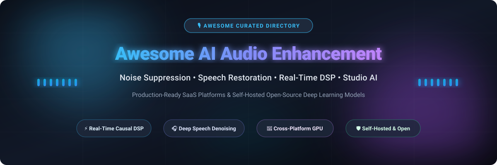

  

# 🎙️ Awesome AI Audio Recording & Enhancement

### 🌟 Curated Directory of Production SaaS Platforms & Self-Hosted Open-Source Deep Learning Frameworks

  
  
  
  
  

  <strong>Transform raw, reverberant, noisy recordings into broadcast-grade audio with state-of-the-art AI.</strong> 
  <em>Noise Suppression • Speech Dereverberation • Causal Real-Time Filtering • Studio Mastering • Voice Separation</em>

---

## 📑 Table of Contents
- [🎯 Overview &amp; Key Features](#-overview--key-features)
- [📊 Sector Overview &amp; Market Dynamics](#-sector-overview--market-dynamics)
- [☁️ SaaS &amp; Hosted Platforms](#️-saas--hosted-platforms)
- [💻 Open-Source GitHub Projects](#-open-source-github-projects)
- [💡 Architectural Guidance &amp; Production Insights](#-architectural-guidance--production-insights)
- [🤝 How to Contribute](#-how-to-contribute)
- [⭐ Star History](#-star-history)
- [💖 Support &amp; Sponsorship](#-support--sponsorship)
- [⚖️ Disclaimer](#️-disclaimer)

---

## 🎯 Overview & Key Features

This repository provides an authoritative, SEO-indexed reference directory tracking leading **commercial SaaS services** and **open-source deep learning repositories** in the **AI Audio Recording & Enhancement** domain. 

Whether you are building real-time teleconferencing pipelines (VoIP/WebRTC), producing studio podcasts, remastering historical speech tracks, or architecting on-device edge DSP models, this index categorizes production tools based on latency performance, licensing, API pricing, and self-hosting readiness.

---

## 📊 Sector Overview & Market Dynamics

The global AI audio processing and speech enhancement sector is projected to surge from **~$3.8B in 2024 to over $18B by 2033** at a rapid **~16.8% CAGR**, spurred by universal demand for remote collaboration fidelity, automated podcast mastering, and multimodal edge devices. 

Market dynamics exhibit a **dual-tier structure**:
- **Application & Software Layer (Moderately Fragmented)**: The market features high competition among specialized startups and creative SaaS providers offering niche vocal repair, generative speech synthesis, and post-production plugins.
- **Infrastructure & Hardware DSP Tier (Highly Concentrated)**: Foundational silicon DSPs, telecom codecs, and low-latency audio frameworks remain concentrated around enterprise titans (Dolby, NVIDIA, Apple, Qualcomm, and Adobe).

---

## ☁️ SaaS & Hosted Platforms

| 🚀 Product | 📝 Description | 🏢 Company Size (Revenue / Valuation) | 💳 Pricing | 🎁 Free Tier Limit |
| :--- | :--- | :--- | :--- | :--- |
| **[Adobe Podcast (Enhance Speech)](https://podcast.adobe.com/)** | AI-powered speech enhancement that removes noise and room echo, creating broadcast-quality vocal isolation. | **~$21.5B+ ARR / ~$100B–$150B Market Cap** (Public: NASDAQ: ADBE) | Starts at **$19.99/month** (Adobe Firefly Pro / Podcast Premium tier) | **Free plan**: Audio only, one file at a time, up to **30 minutes and 500 MB per file**, **1 hour of enhancement per day**, 2 Studio project downloads per day (up to 30 min each). |
| **[Descript](https://www.descript.com/)** | All-in-one audio/video editor with AI features including Studio Sound, Overdub voice cloning, and AI clip generation. | **~$55M ARR / $550M Valuation** (Series C funded) | Hobbyist tier starts at **$16/seat/month** (billed annually) or **$19/month** (billed monthly) | **Free plan**: **60 media minutes/month**, **100 one-time AI credits**, 1 seat, 720p watermarked exports. |
| **[Krisp](https://krisp.ai/)** | Real-time bi-directional AI noise cancellation for calls and meetings, with automated transcription and meeting notes. | **~$38M–$41M ARR / ~$70M–$100M+ Valuation** (Series A-1 funded) | Pro tier starts at **$8/month** (billed annually) or **$16/month** (billed monthly) | **Free plan**: **60 minutes/day** of noise cancellation, unlimited meeting transcriptions, 2 AI note summaries/day, 7-day history. |
| **[Riverside.fm](https://riverside.fm/)** | High-fidelity remote recording studio with uncompressed local capture, Magic Audio enhancement, and AI editing. | **~$35M–$56M ARR / ~$200M–$450M Valuation** (Series C funded) | Pro tier starts at **$24/month** (billed annually) or **$29/month** (billed monthly) | **Free plan**: **2 hours of separate-track recording (one-time trial, not monthly)**, unlimited single-track recording, 720p watermarked exports. |
| **[Auphonic](https://auphonic.com/)** | Automatic audio mastering web service featuring intelligent leveling, loudness normalization (EBU R128), and noise reduction. | **~$380K–$1M+ ARR** (Bootstrapped / Indie) | Recurring plans start at **$11/month** (for 9 hours/month; 20% discount on yearly billing) | **Free plan**: **2 hours of processed audio per month** (includes Auphonic audio jingle mark). |

---

## 💻 Open-Source GitHub Projects

Curated self-hostable libraries and deep learning architectures sorted in descending order by GitHub stargazers:

1. ### 🎼 **[facebookresearch/demucs](https://github.com/facebookresearch/demucs)** 
   - **Focus:** Music source separation and vocal extraction via Hybrid Spectrogram and Waveform Domain U-Net.
   - **License:** MIT
   - **Highlights:** State-of-the-art isolation of vocals, drums, bass, and other stems. Ideal for isolating speech or dialogue tracks from heavily mixed audio prior to downstream enhancement.

2. ### ⚡ **[xiph/rnnoise](https://github.com/xiph/rnnoise)** 
   - **Focus:** Recurrent neural network (RNN / GRU) based real-time audio noise suppression in C.
   - **License:** BSD-3-Clause
   - **Highlights:** Extreme computational efficiency with negligible latency (<10ms). Battle-tested in production VoIP, WebRTC conferencing, and embedded Linux/microcontroller devices.

3. ### 🎛️ **[Rikorose/DeepFilterNet](https://github.com/Rikorose/DeepFilterNet)** 
   - **Focus:** Low-complexity real-time speech enhancement and dereverberation using deep filtering in Rust and PyTorch.
   - **License:** MIT
   - **Highlights:** Causal multi-frame deep filtering standard for real-time speech processing. Supports standard CLI `deepFilter input.wav` and Python bindings with multi-platform CPU and CUDA acceleration.

4. ### 🔊 **[resemble-ai/resemble-enhance](https://github.com/resemble-ai/resemble-enhance)** 
   - **Focus:** Deep learning speech denoising and high-frequency spectral speech restoration.
   - **License:** MIT
   - **Highlights:** Two-stage neural architecture separating background noise suppression from generative voice enhancement to recover muffled or low-sample-rate audio recordings.

5. ### 🎧 **[facebookresearch/denoiser](https://github.com/facebookresearch/denoiser)** 
   - **Focus:** Real-time speech enhancement in the raw waveform domain (Demucs-based causal architecture).
   - **License:** CC-BY-NC 4.0 / Research
   - **Highlights:** Operates directly on raw audio waveforms with encoder-decoder skip connections to cancel stationary and non-stationary noises with low latency on standard laptop CPUs.

6. ### 🏆 **[microsoft/DNS-Challenge](https://github.com/microsoft/DNS-Challenge)** 
   - **Focus:** Microsoft Deep Noise Suppression baseline models, perceptual audio quality metrics, and evaluation datasets.
   - **License:** CC-BY-4.0
   - **Highlights:** Benchmark dataset, ITU-T P.835 testing harnesses, and baseline neural models for state-of-the-art academic and industry noise suppression comparison.

7. ### 🛠️ **[haoheliu/voicefixer](https://github.com/haoheliu/voicefixer)** 
   - **Focus:** General speech restoration for degraded speech across noise, room reverb, distortion, and bandwidth limitation.
   - **License:** MIT
   - **Highlights:** Neural vocoder and resonator pipeline capable of reconstructing missing high-frequency harmonics and restoring historical archival recordings to 44.1kHz studio clarity.

8. ### 🦀 **[lona-cn/anr](https://github.com/lona-cn/anr)** 
   - **Focus:** Lightweight Rust-based noise reduction library using DFN3 models with multi-backend compute shaders.
   - **License:** Apache-2.0
   - **Highlights:** Direct GPU execution using Vulkan, Direct3D 12, OpenGL ES, and wgpu compute shaders without requiring heavy Python or ONNX Runtime runtimes.

---

## 💡 Architectural Guidance & Production Insights

- ⏱️ **Real-Time Streaming vs. Batch Post-Production:**
  - For live streams, voice chat, and VoIP (latency under 20ms), choose **RNNoise**, **DeepFilterNet**, or **Krisp**.
  - For high-definition mastering and podcast editing where lookahead and computational budget are flexible, deploy **Resemble Enhance**, **VoiceFixer**, or **Adobe Podcast**.
- 🔓 **Self-Hosting Benefits:**
  - Open-source implementations eliminate recurring SaaS per-minute billing, protect user biometric privacy, and provide custom model fine-tuning on domain-specific acoustic profiles.

---

## 🤝 How to Contribute

Contributions are welcome! Please follow these guidelines:
1. 🍴 Fork the repository.
2. 🌿 Create a feature branch (`git checkout -b feature/audio-tool`).
3. ✏️ Add your verified entry adhering to the markdown formatting standards (include official links, factual benchmarks, and Stars_Badges).
4. 🚀 Open a Pull Request detailing the model architecture or service characteristics.

---

##  Star History

---

## 💖 Support & Sponsorship

If this curated ecosystem helps your development workflow, research, or audio processing infrastructure:
- ⭐ **Star** this repository on GitHub to boost visibility.
- 🍴 **Fork** and contribute models or tools you use.
- 📢 **Share** with your network and audio engineering communities.
- ☕ **Buy me a coffee / Sponsor**: Support ongoing maintenance via the [GitHub Sponsors Dashboard](https://github.com/sponsors/ishandutta2007).

---

## ⚖️ Disclaimer

- This list is **community-curated** for educational, engineering, and architectural comparison purposes.
- Trademarks, product logos, and service names belong to their respective corporate owners.
- Free tier thresholds and pricing terms are accurate as of October 2026 and remain subject to change by respective SaaS vendors.
